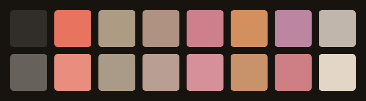
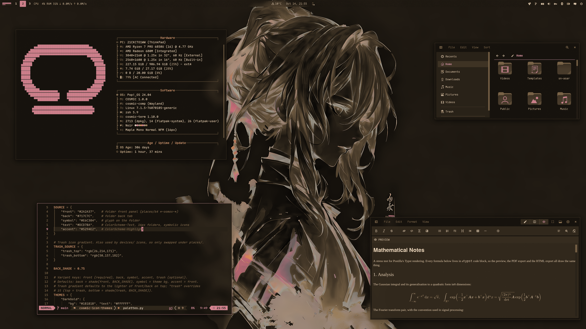

<div align="center">

# COSMIC · Blush Night



Pop!_OS 24.04 on COSMIC in espresso, sand and rose: desktop, terminal,
shell, Firefox, Brave, cursor, wallpapers. A dark rice in desert pinks;
crimson is kept for what is wrong. The dark half of a pair;
the light half is [cosmic-blush-theme](https://github.com/atraxsrc/cosmic-blush-theme).


</div>

---


## Palette

Espresso, a warm brown-black, with sand text and desert browns between
them: taupe, cocoa, mocha and walnut. Rose is the accent, copper takes
numbers and warnings, and crimson is kept for errors and nothing else.
Every text colour is at least 4.5:1 on the window background.

| Role | Color | Hex |
|------|-------|-----|
| Background |  Espresso |  `#17130E` |
| Containers |  Umber / Bark |  `#25211D` /  `#312D28` |
| Text |  Sand |  `#DACCBC` |
| Accent |  Rose |  `#CD7F8B` |
| Warning |  Copper |  `#D48F5E` |
| Error |  Crimson |  `#E8735E` |
| Success |  Mocha |  `#AE9B84` |
| Walnut |  Symlinks, yellow slot |  `#B09282` |
| Cocoa |  Directories, types |  `#9A958E` |
| Muted |  Secondary text |  `#858079` |
| Dim |  Comments |  `#66615A` |
| Lines |  Box lines, inactive |  `#54504C` |

| Role | Blush Night | Blush |
|------|---|---|
| Background |  `#17130E` |  `#F5E6D3` |
| Text |  `#DACCBC` |  `#35302A` |
| Accent |  `#CD7F8B` |  `#9E4F5B` |
| Success |  `#AE9B84` |  `#76634C` |
| Error |  `#E8735E` |  `#A02B16` |

The accent is rose, 6.2:1 on the background and 5.3:1 on a container,
so it stays the same colour wherever it is text; buttons and selections
carry it with espresso text on top.

---

## Repo Structure

```
.
├── brave
│   ├── theme                    # Chromium theme (manifest + icons), Load unpacked
│   └── README.md
├── btop
│   └── BlushNight.theme                 # btop colour theme
├── claude-desktop
│   ├── cosmic-blush.jsonc          # Claude Desktop theme (claude-desktop-extra)
│   └── install.sh
├── cosmic
│   ├── BlushNight.ron                   # COSMIC Appearance import (Dark)
│   ├── config/                  # baseline settings: fonts, icons, terminal look
│   └── install.sh
├── cosmic-term
│   ├── BlushNight-term.ron              # COSMIC Terminal colour scheme
│   ├── BlushNight-term-*.ron            # dimmer plain-text variants, same ANSI colours
│   └── README.md                # previews and which one to pick
├── cursors
│   ├── Oxygen-BlushNight-*/             # cursor themes, one per icon colour, patched for COSMIC apps
│   ├── recolour.py              # makes a variant from any other, see cursors/README.md
│   ├── install.sh
│   ├── uninstall.sh
│   └── README.md
├── icons
│   └── install.sh               # Cosmic-BlushNight icon pack from cosmic-icon-themes
├── fastfetch
│   ├── config.jsonc             # rose / cocoa fastfetch config
│   ├── cosmic.txt               # COSMIC logo
│   └── install.sh
├── firefox
│   ├── theme                    # Cosmic Blush Night theme add-on (manifest + icons)
│   ├── chrome
│   │   ├── userChrome.css       # rounded chrome, umber menus
│   │   └── userContent.css      # new tab accent
│   ├── install.sh
│   └── README.md
├── lsd
│   ├── config.yaml              # theme: custom
│   ├── colors.yaml              # permission / size / date / git columns
│   └── install.sh
├── nvim                         # Neovim colorscheme, LazyVim spec, RON syntax, install.sh
├── telegram
│   ├── colors.tdesktop-theme    # Telegram Desktop colour scheme (source)
│   ├── cosmic-blushnight.tdesktop-theme # built theme, open this in Telegram
│   └── build.sh                 # rebuilds it, optionally with a wallpaper
├── vscode
│   ├── themes/                  # Cursor / VS Code colour themes, Blush Night (dark) + Blush (light)
│   ├── package.json             # extension manifest
│   ├── install.sh               # packs a .vsix, installs it with cursor --install-extension
│   └── README.md
├── scripts
│   ├── update_system.sh         # nala + flatpak, rose / mocha ANSI
│   └── switch.sh                # make this the active rice (see Switching rice)
├── zsh
│   ├── blushnight.zsh                   # LS_COLORS, highlighting colours, aliases, starship
│   └── install.sh
├── assets
│   ├── cursors/                 # cursor preview
│   ├── cosmic-term/             # scheme previews for cosmic-term/README.md
│   ├── palette.png              # the 16 terminal colours, under the title
│   ├── screenshot.png           # README screenshot
│   └── wallpaper.png            # the dunes wallpaper at 2560x1440
├── backgrounds/                 # wallpapers, blushnight-<subject>.png (see Icons and wallpaper)
├── docs
│   └── showcase.md              # the rice describing itself, for the Postilla pane of a screenshot
├── LICENSE
└── README.md
```

---

## COSMIC Desktop

Settings → Desktop → Appearance → **Dark** → **Import** → `cosmic/BlushNight.ron`

Accent is rose  `#CD7F8B`. Use the `+` control if you want a custom swatch.

Frosted glass is on in the `.ron` at `frosted: Low` with an opacity table of
0.66 to 0.96, tinted with the palette's dim grey, for windows, panel,
applets and system UI (maximized apps stay solid), and corners are squared
(`radius_*: 2.0`), the same as the DarkGold baseline. Adjust frosted glass on
Appearance → Style → Frosted glass after import; those sliders survive a theme switch.

Export from Appearance if you tweak backgrounds / tints so you do not lose them.

Pairing tip: import `Blush.ron` from
[cosmic-blush-theme](https://github.com/atraxsrc/cosmic-blush-theme) into the
Light slot and COSMIC's Dark / Light toggle flips between the two. Wallpaper,
Firefox and the shell layer do not follow the toggle; those are per-rice files.

### Baseline settings

`cosmic/config/` holds the settings that make up the look and rarely change
(panel, dock, applets and shortcuts are left out on purpose):

| Where | Setting |
|-------|---------|
| Fonts | Interface `Maple Mono Normal` Light, monospace `Maple Mono Normal NFM` |
| Icons | Cosmic-BlushNight-Rose |
| Windows | Minimize / maximize buttons hidden, theme applied to GNOME apps |
| Terminal | Maple Mono 15 (weights 500 / bold 800 / dim 300), 77% opacity, no header bar, Blush Night |

Install the [Maple fonts](https://github.com/subframe7536/maple-font/releases)
(Maple Mono Normal and Maple Mono Normal NFM) and the Cosmic-BlushNight icons (see
Icons below) and import the terminal scheme first, then:

```bash
./cosmic/install.sh
```

It backs up each file it replaces to `*.bak` and COSMIC applies it live.

The interface font is the Light weight on purpose. COSMIC sets interface text
brightness itself (the text tint only picks the hue), so on these dark panels
labels land near  `#BDA79C` whatever tint you choose; the thinner strokes are
what calms them at night. Settings → Fonts lists only families, so the weight
lives in `cosmic/config/com.system76.CosmicTk/v1/interface_font`.

---

## COSMIC Terminal

The desktop `.ron` does not colour ANSI text.

1. COSMIC Terminal → **View → Color schemes…** (not Settings → Appearance)
2. Dark tab → **Import** → `cosmic-term/BlushNight-term.ron`
3. View → Settings → Appearance → Color scheme (dark) → **Blush Night**

If a profile is set as default, set the scheme on that profile too or the
dropdown will look like it did nothing.

Sand text on espresso; crimson for errors, rose for the cursor and the
`blue` slot, mocha for strings and success, walnut in the yellow slot, copper
in the magenta slot for numbers, cocoa for directories.

If sand glares at night, there are five dimmer variants with the same ANSI
colours, from Taupe  `#858079` up to Mink  `#CBBDAD`. Previews and which to
pick: [`cosmic-term/README.md`](cosmic-term/README.md).

---

## Firefox

Two layers:

1. **Theme (colours):** `firefox/theme` is a WebExtension theme, **Cosmic Blush Night**.
   Until it is listed on addons.mozilla.org, load it from the folder:
   `about:debugging#/runtime/this-firefox` → **Load Temporary Add-on** →
   `firefox/theme/manifest.json` (gone on restart), or zip it and have AMO
   sign it for you; see [`firefox/README.md`](firefox/README.md).
   This is the main look.
2. **Stylesheets (optional):** `firefox/chrome/` adds rounded corners, rose
   menu hover, rose accents and blank new-tab tiles on top of the theme
   (they also work with Firefox's built-in Dark theme):

```bash
./firefox/install.sh
```

Fully quit Firefox afterward. Details and CSS rules: [`firefox/README.md`](firefox/README.md).

---

## Brave

`brave/theme` is a Chromium theme with the Firefox theme's colours: espresso
frame, umber toolbar, mocha icons and inactive tabs, rose on the
active tab. Brave, Chrome, Chromium and Edge take it, and it loads straight
from the clone, so no Chrome Web Store or Google account is needed:

`brave://extensions` → **Developer mode** → **Load unpacked** → `brave/theme`

Leave the clone in place, Brave keeps reading the folder. Colours, limits and
packing a `.crx`: [`brave/README.md`](brave/README.md).

---

## Claude Desktop

For the unofficial [claude-desktop-extra](https://github.com/patrickjaja/claude-desktop-extra)
Linux build. `claude-desktop/cosmic-blush.jsonc` is one theme with both halves:
Blush Night in dark mode and Blush in light mode, so Claude's own
Settings → Appearance toggle switches between the two rices.
Colours come from `cosmic/*.ron`, contrast-checked (text and
button text 4.5:1, accents 3:1).

```bash
./claude-desktop/install.sh
```

It copies the file into `~/.config/Claude/themes.d/`. Then press
<kbd>Ctrl</kbd>+<kbd>Shift</kbd>+<kbd>T</kbd> in Claude Desktop and pick **cosmic-blush**.

The same file ships in [`cosmic-blush-theme`](https://github.com/atraxsrc/cosmic-blush-theme),
so installing from either repo gives the same theme.

---

## Cursor editor

`vscode/` is a colour theme extension for [Cursor](https://cursor.com) with
both halves of the pair: **Cosmic Blush Night** and **Cosmic Blush**. It is a
plain VS Code theme extension, so VS Code and VSCodium take it too, and the
same extension ships in cosmic-blush-theme. Code is coloured the way Neovim is
in the rice; the workbench is
espresso with umber menus, hovers and inputs, rose on the active tab, buttons
and menu highlight, and the integrated terminal uses the COSMIC Terminal
scheme. Cursor builds its Agent and chat panels from the same theme colours,
so they follow along.

```bash
./vscode/install.sh
```

It packs `vscode/` into a `.vsix` and installs it with
`cursor --install-extension`; run it again after editing the theme. Then press
<kbd>Ctrl</kbd>+<kbd>K</kbd> <kbd>Ctrl</kbd>+<kbd>T</kbd> in Cursor and pick
**Cosmic Blush Night**. Three lines in Cursor's `settings.json` make it follow
COSMIC's Dark / Light toggle between Blush and Blush Night; they, the colours and
the contrast notes are in [`vscode/README.md`](vscode/README.md).

---

## Telegram

`telegram/cosmic-blushnight.tdesktop-theme` is a Telegram Desktop theme: espresso chat
list and background, umber incoming and dark-mocha outgoing bubbles, rose
for the accent, links, unread badges and buttons (with espresso text on them),
mocha for online status and read ticks, crimson only where Telegram marks
something wrong. Group member names cycle through eight of the rice's
colours. Text and badge colours are contrast-checked at 4.5:1 or better,
except disabled menu items.

Settings → Chat Settings → Chat wallpaper → **Choose from file** →
`telegram/cosmic-blushnight.tdesktop-theme` → **Apply this theme**.

The colours live in `telegram/colors.tdesktop-theme`, which is plain text;
`build.sh` zips it with the chat background into the `.tdesktop-theme`. The
background is plain espresso; to put a wallpaper behind the chat instead
(ImageMagick re-encodes it to a 2560px JPEG, Telegram caps theme files at 5 MB):

```bash
./telegram/build.sh --wallpaper backgrounds/blushnight-dunes.jpg
```

Built against Telegram Desktop 7.3.1. Calls, group calls, statistics charts and
premium badges keep Telegram's own colours.

Telegram has no dark / light pairing, so Blush, the light half, ships its
own theme.

---

## Cursor

**Oxygen** cursors recoloured to the icon colours, one per folder colour of the
Cosmic-BlushNight icon pack: **Rose** (default), **Crimson**, **Dark**. Patched with the cursor
names COSMIC apps ask for. COSMIC has no cursor picker yet, so the script sets it:

```bash
./cursors/install.sh                      # Rose
./cursors/install.sh --variant Dark      # or another, see --list
reboot
```

Previews, what the script touches, how to undo it and how the colours are made:
[`cursors/README.md`](cursors/README.md).

---

## Scripts

### `update_system.sh`

nala + flatpak updater. Headers in rose, info in cocoa, success in mocha,
warnings in copper, errors in crimson; the banner ramps from mocha to
walnut, the rule below it from rose into mocha.

```bash
chmod +x scripts/update_system.sh
./scripts/update_system.sh
```

### `switch.sh`

Makes this the active rice, coming from any other `cosmic-*-theme` rice. See
[Switching rice](#switching-rice).

```bash
./scripts/switch.sh
```

---

## Terminal extras

Need a [Nerd Font](https://www.nerdfonts.com/) in the terminal for the icons
(Maple Mono NFM in the baseline above).

### zsh

`zsh/blushnight.zsh` is the rice part of the shell only: `LS_COLORS` (also used by
lsd for file names and by the completion menu), rose / mocha / walnut colours
for zsh-autosuggestions and zsh-syntax-highlighting, lsd / bat / nvim aliases
and the starship prompt. Your own `~/.zshrc` stays private and sources it.

Needs zsh + [oh-my-zsh](https://ohmyz.sh/). `install.sh` clones the two
plugins if missing and appends one `source` line to `~/.zshrc` (backup in
`~/.zshrc.bak`):

```bash
./zsh/install.sh
exec zsh
```

In `~/.zshrc` keep `ZSH_THEME=""` and
`plugins=(git sudo zsh-autosuggestions zsh-syntax-highlighting)`.

### lsd

File names are coloured by `LS_COLORS` from `zsh/blushnight.zsh`;
`lsd/colors.yaml` colours the other columns with the 256-colour codes nearest
the palette (174 rose, 167 crimson, 173 copper, 246 mocha, 138 walnut,
246 cocoa, 246 taupe, 138 clay.). lsd 1.0.0 does not accept `#hex` there.

```bash
./lsd/install.sh
lsd -l
```

### fastfetch

COSMIC logo in rose, Hardware / Software / Age boxes in dim grey with
cocoa keys. `install.sh` backs up any existing
`~/.config/fastfetch/config.jsonc` to `config.jsonc.bak`.

```bash
./fastfetch/install.sh
fastfetch
```

### Neovim

`nvim/` carries the rice into Neovim: a dependency-free colorscheme built from
the palette (`nvim/colors/blushnight.lua`), a LazyVim spec that selects it and makes
sure the treesitter parsers for the files in this repo are installed
(`nvim/lua/plugins/blushnight.lua`), and a small RON syntax file so `cosmic/*.ron`
is coloured even before the parser exists. `:terminal` inside Neovim uses the
Blush Night scheme.

```bash
./nvim/install.sh
# restart nvim; LazyVim switches to the blushnight colorscheme
```

Without LazyVim, copy `nvim/colors/blushnight.lua` to `~/.config/nvim/colors/` and
run `:colorscheme blushnight`.

### btop

`btop/BlushNight.theme`: espresso background, dim grey boxes, rose titles, meters
ramp from mocha through walnut to crimson.

```bash
mkdir -p ~/.config/btop/themes
cp btop/BlushNight.theme ~/.config/btop/themes/
# btop → Esc → Options → Color theme → Blush Night
```

---

## Icons and wallpaper

Icons: **Cosmic-BlushNight**, the [Kanagawa icons](https://github.com/Fausto-Korpsvart/Kanagawa-GKT-Theme/tree/main/icons/Kanagawa)
by Fausto Korpsvart recolored to this palette in
[cosmic-icon-themes](https://github.com/atraxsrc/cosmic-icon-themes). Folders come in
three colors: **Rose**  `#CD7F8B` (default), **Crimson**  `#E8735E` and **Dark**  `#312D28` with rose symbols.


```bash
./icons/install.sh                       # Rose folders
./icons/install.sh --variant Crimson  # or Dark
```

It downloads the pack from the latest cosmic-icon-themes release, checks its SHA256,
installs it to `~/.local/share/icons/` and sets it as the COSMIC icon theme.
Restart open apps afterwards (Files caches icons per window).
Add `--system` to install to `/usr/share/icons` instead, for every user and the
login screen (asks for sudo); `--user` is the default.

Wallpapers ship in [`backgrounds/`](backgrounds/), named `blushnight-<subject>`, the same pictures as Blush:
six scenes in pink and espresso: dunes under a peach sky, a paisley swirl,
balloons over a meadow at sunset, a lone blossom tree in snow, a blossom
branch on pink and a pink garden with arches, plus the anime portrait
from the screenshot (`blushnight-anime.png`) in the palette's own tones. The
dunes (`blushnight-dunes.jpg`) are the one in `assets/wallpaper.png` at
2560x1440.

Settings → Wallpaper → Add image → a file from `backgrounds/`, or one you downloaded.

---

## Setup

```bash
git clone https://github.com/atraxsrc/cosmic-blushnight-theme.git
cd cosmic-blushnight-theme

# desktop
# Settings → Appearance → Dark → Import cosmic/BlushNight.ron

# terminal
# View → Color schemes → Import cosmic-term/BlushNight-term.ron

# firefox theme: about:debugging → Load Temporary Add-on → firefox/theme/manifest.json
# (or zip and sign it, see firefox/README.md)

# optional extra chrome
./firefox/install.sh

# brave: brave://extensions → Developer mode → Load unpacked → brave/theme

# claude desktop (claude-desktop-extra), then Ctrl+Shift+T
./claude-desktop/install.sh

# cursor editor, then Ctrl+K Ctrl+T → Cosmic Blush Night
./vscode/install.sh

# telegram desktop
# Settings → Chat Settings → Chat wallpaper → Choose from file → telegram/cosmic-blushnight.tdesktop-theme

# cursor (then reboot), see cursors/README.md
./cursors/install.sh                      # Rose
./cursors/install.sh --variant Dark      # or another, see --list
reboot

# shell + terminal tools (see Terminal extras above)
./zsh/install.sh
./lsd/install.sh
./fastfetch/install.sh
./nvim/install.sh
mkdir -p ~/.config/btop/themes && cp btop/BlushNight.theme ~/.config/btop/themes/

# wallpaper
# Settings → Wallpaper → Add image → a file from backgrounds/ (see Icons and wallpaper above)

./icons/install.sh                  # icons (see Icons above)
# Maple fonts (https://github.com/subframe7536/maple-font), then
# fonts, icons, terminal look from cosmic/config/
./cosmic/install.sh
```

---

## Switching rice

The installers replace what they own (with a `*.bak` copy), but some things
pile up instead: shell layers in `~/.zshrc`, LazyVim specs, the updater link and
btop's theme setting. `scripts/switch.sh` makes Blush Night the active rice, coming
from any other `cosmic-*-theme` rice, and tidies those up. Every rice repo ships
the same script.

```bash
./scripts/switch.sh               # switch, icons included
./scripts/switch.sh --keep-icons  # leave the current icon theme alone
```

It backs up every file it replaces, then:

- copies `cosmic/config/` (fonts, terminal look, icons) and turns dark mode on.
  The terminal scheme and icon theme are only replaced when the current one is
  not already a Blush Night variant, so a dimmer text variant or another icon colour
  survives. Icons stay as they are until `./icons/install.sh` has run.
- runs the fastfetch, lsd, Neovim and Claude Desktop installers and sets
  btop's `color_theme`
- moves every other rice's LazyVim spec from `~/.config/nvim/lua/plugins/` to
  `~/.config/nvim/rice-off/` (LazyVim loads every spec there and the last
  colorscheme wins); your own specs stay
- comments out every other rice's `source` line in `~/.zshrc`, and
  cosmic-ricing's `ricing/zsh/colors.zsh`, then uncomments Blush Night's or adds it
- points `~/update_system.sh` at this repo's updater
- installs the Firefox userChrome / userContent

The GUI steps it cannot do are printed at the end:

1. Settings → Desktop → Appearance → Dark → Import `cosmic/BlushNight.ron`
2. COSMIC Terminal → View → Color schemes → Dark tab → Import `cosmic-term/BlushNight-term.ron`
3. Firefox: disable the old rice's add-on, enable this one, restart Firefox
4. Settings → Wallpaper → a file from `backgrounds/`
5. Claude Desktop: Ctrl+Shift+T → `cosmic-blush`, Appearance → Dark
6. `exec zsh`, restart Neovim (`:Lazy clean` drops plugins only the old specs used)

Skip 1 and 2 when that slot already holds Blush Night. The first time on this rice,
run [Setup](#setup) once for the fonts, icons and cursor.

**Within the pair** (Blush Night ↔ [Blush](https://github.com/atraxsrc/cosmic-blush-theme)): the two halves
sit side by side in COSMIC's Dark and Light slots and share one Claude Desktop
theme, so after the first time only the Firefox add-on and the wallpaper are
left by hand. Add `--keep-icons` to keep one icon colour across the pair.

Leaving Blush Night is the next rice's `./scripts/switch.sh`. `./cursors/uninstall.sh`
puts the Pop cursor back.

---

## Stack

| Tool | What it does |
|------|-------------|
| [Pop!_OS 24.04](https://pop.system76.com/) | Base OS by System76 |
| [COSMIC DE](https://system76.com/cosmic) | Desktop environment |
| [oh-my-zsh](https://ohmyz.sh/) | zsh framework + plugins |
| [lsd](https://github.com/lsd-rs/lsd) | `ls` with icons and colours |
| [fastfetch](https://github.com/fastfetch-cli/fastfetch) | System info |
| [btop](https://github.com/aristocratos/btop) | Resource monitor |
| [cosmic-icon-themes](https://github.com/atraxsrc/cosmic-icon-themes) | Icon pack (Cosmic-BlushNight), recolored from [Kanagawa icons](https://github.com/Fausto-Korpsvart/Kanagawa-GKT-Theme/tree/main/icons/Kanagawa) |
| [Oxygen-Cursors](https://github.com/wo2ni/Oxygen-Cursors) | Cursor, recoloured to the icon colours |

## Credits

- Shared baseline (frosted glass, squared corners, fonts, the Firefox and
  Chromium theme recipes, the scripts) from
  [cosmic-darkgold-theme](https://github.com/atraxsrc/cosmic-darkgold-theme) and
  [cosmic-noir-theme](https://github.com/atraxsrc/cosmic-noir-theme).

## License

MIT. The cursor artwork keeps the terms of KDE's Oxygen project, see
[`cursors/README.md`](cursors/README.md).
