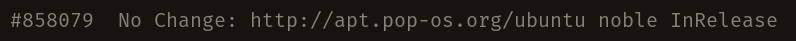
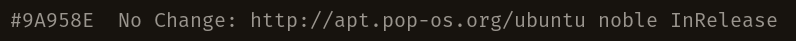
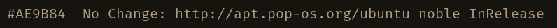
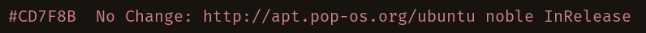
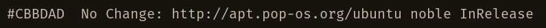

# COSMIC Terminal schemes

Colour schemes for COSMIC Terminal. The desktop `.ron` in `cosmic/` does not
colour ANSI text, so the terminal needs its own import.

1. COSMIC Terminal → **View → Color schemes…** (not Settings → Appearance)
2. **Dark** tab → **Import** → a `.ron` from this folder
3. View → Settings → Appearance → Color scheme (dark) → the scheme name

If a profile is set as default, set the scheme on that profile too or the
dropdown will look like it did nothing. `cosmic/install.sh` selects **Blush Night**,
so import that one at least.

Every scheme here keeps the 16 ANSI colours of Blush Night. Only the plain text
colour and the dim text change, so bat, lsd, starship, nala and btop look the
same whichever one you pick. The cursor stays rose  `#CD7F8B`.

The ANSI slots follow the rice: `red` is crimson  `#E8735E`, the one colour
kept for what is wrong; `green` is mocha  `#AE9B84`; `yellow` is walnut
 `#B09282`; `blue` is the rose accent  `#CD7F8B`, so nala's `Updated:` and
`Downloaded:` labels sit in the rice's own colour next to the mocha
`No Change:`; `magenta` is copper  `#D48F5E`, the warm colour numbers and
warnings take; `cyan` is taupe  `#BC85A2`; `white` is
 `#C1B6AC`. Directories are not affected: `LS_COLORS` in `zsh/blushnight.zsh` colours
them in truecolor.

## Which one

Sand  `#DACCBC` is the default. The others move through Blush Night's own greys
and tints: calmer above it, brighter below it, for whoever finds the default
glares at night or reads too dim by day.

| Scheme | Plain text | Contrast | Also used for |
|--------|------------|----------|---------------|
| Blush Night Taupe |  `#858079` | 4.7:1 | muted text, the dim text colour |
| Blush Night Cocoa |  `#9A958E` | 6.2:1 | directories (`LS_COLORS`), types |
| Blush Night Mocha |  `#AE9B84` | 6.9:1 | strings, success, the `green` slot |
| Blush Night Rose |  `#CD7F8B` | 6.2:1 | the accent, the cursor and the `blue` slot |
| Blush Night Mink |  `#CBBDAD` | 10.1:1 | a neutral a step from plain text |
| **Blush Night** (default) |  `#DACCBC` | 11.7:1 | the desktop text colour |
When plain text shares a colour with an ANSI slot, output in that slot stops
standing out: directories in Blush Night Cocoa, for example, look like plain text.
Crimson errors and copper numbers stand out more against the dimmer
schemes than against sand.

**Bold:** `bright_foreground` ( `#E4D6C6`) only colours bold text when
`use_bright_bold` is on. The baseline config in `cosmic/config/` leaves it off,
so bold text is the plain text colour at weight 800.

Previews are rendered in Fira Mono on the theme background  `#17130E`, not
taken from the terminal. In COSMIC you get Maple Mono at 77% opacity over the
wallpaper, so text looks a little softer and contrast a little lower.

## Dark

**Blush Night** · `BlushNight-term.ron` · sand  `#DACCBC`, 11.7:1. The default.

**Blush Night Taupe** · `BlushNight-term-taupe.ron` ·  `#858079`, 4.7:1. Muted text, the dim text colour.

**Blush Night Cocoa** · `BlushNight-term-cocoa.ron` ·  `#9A958E`, 6.2:1. Directories (`LS_COLORS`), types.

**Blush Night Mocha** · `BlushNight-term-mocha.ron` ·  `#AE9B84`, 6.9:1. Strings, success, the `green` slot.

**Blush Night Rose** · `BlushNight-term-rose.ron` ·  `#CD7F8B`, 6.2:1. The accent, the cursor and the `blue` slot.

**Blush Night Mink** · `BlushNight-term-mink.ron` ·  `#CBBDAD`, 10.1:1. A neutral a step from plain text.

Contrast is plain text on the theme background, WCAG 2.
